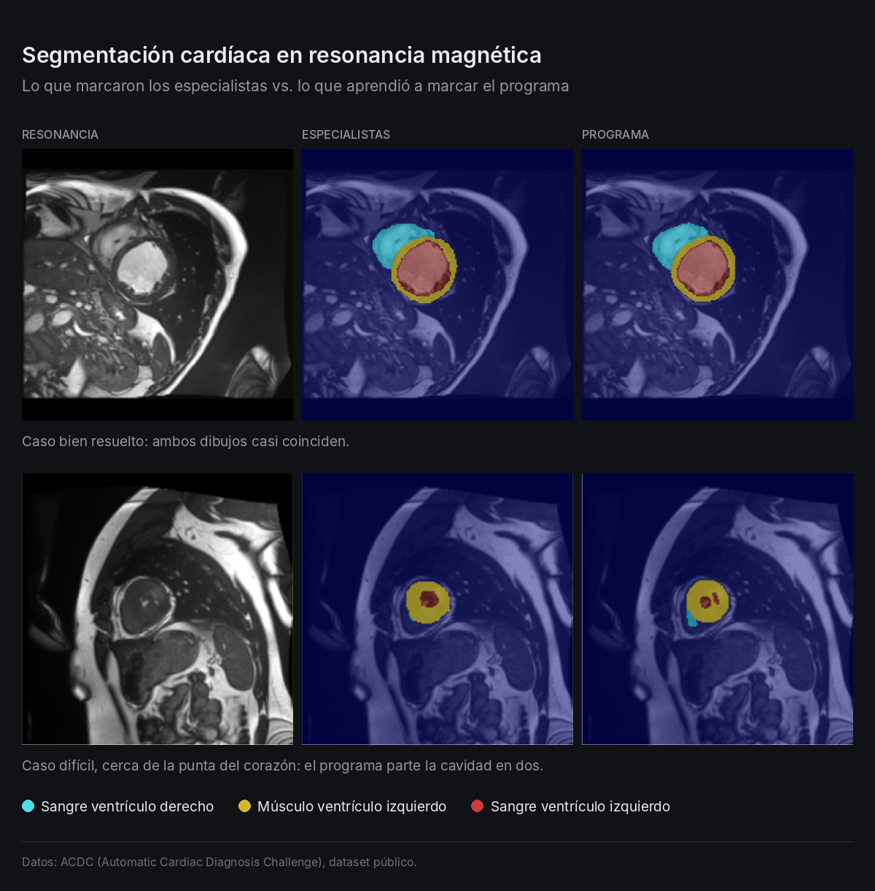
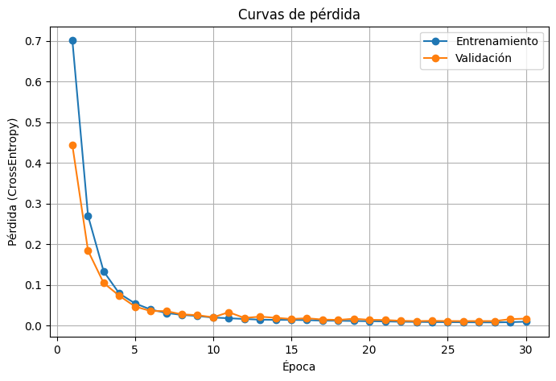

# Segmentación cardíaca en resonancia magnética con U-Net

Modelo de deep learning que segmenta automáticamente estructuras del corazón en imágenes de resonancia magnética cardíaca, implementado desde cero en PyTorch.



## Resumen

A partir de cortes 2D de resonancia magnética cardíaca, el modelo marca pixel por pixel tres estructuras anatómicas:

| Clase | Estructura |
|---|---|
| 0 | Fondo |
| 1 | Cavidad del ventrículo derecho (RV) |
| 2 | Miocardio del ventrículo izquierdo (MYO) |
| 3 | Cavidad del ventrículo izquierdo (LV) |

Las máscaras de referencia (*ground truth*) fueron trazadas manualmente por expertos clínicos y forman parte del dataset público.

## Resultados

Coeficiente DICE en el set de test (192 imágenes que el modelo no vio durante el entrenamiento):

| Estructura | DICE |
|---|---|
| Cavidad ventrículo izquierdo (LV) | **0,954** |
| Cavidad ventrículo derecho (RV) | **0,913** |
| Miocardio (MYO) | **0,883** |
| Promedio estructuras cardíacas | **0,917** |

**Hallazgos principales**
- **No se observa overfitting:** las curvas de entrenamiento y validación bajan juntas y la brecha final es pequeña.
- **El miocardio es la estructura más difícil.** Es un anillo delgado con dos bordes, por lo que pequeños errores de contorno pesan mucho en la métrica.
- **Los errores se concentran en cortes cercanos al ápice,** donde la cavidad del ventrículo izquierdo es muy pequeña y el miocardio se ve grueso.

<p align="center">
  
</p>

## Metodología

**Datos.** [ACDC – Automatic Cardiac Diagnosis Challenge](https://www.kaggle.com/datasets/anhoangvo/acdc-dataset): 1.912 cortes 2D, redimensionados a 200×200 manteniendo la proporción (interpolación bilineal para la imagen y *nearest neighbor* para la máscara). Se dividieron en 80% entrenamiento, 10% validación y 10% test, con semilla fija.

**Arquitectura.** U-Net de 4 niveles:
- **Encoder:** bloques Conv 3×3 → BatchNorm → ReLU (×2) y MaxPool. Los canales crecen de 32 a 512.
- **Decoder:** convoluciones transpuestas con *skip connections* y ajuste de tamaño (*padding*), necesario porque 200 no es divisible por 16 (25 → 12 → 24).
- **Salida:** convolución 1×1 que entrega 4 canales (logits).

**Entrenamiento.**

| Hiperparámetro | Valor |
|---|---|
| Función de pérdida | CrossEntropyLoss |
| Optimizador | Adam, lr = 1×10⁻³ |
| Batch size | 32 |
| Épocas | 30, conservando el modelo con menor pérdida de validación (época 23) |
| Hardware | GPU NVIDIA T4 (Google Colab) |

## Estructura del repositorio

```
├── segmentacion_cardiaca_unet.ipynb   # Notebook completo con código, resultados y análisis
├── images/                            # Figuras de resultados
├── requirements.txt
└── README.md
```

## Cómo ejecutarlo

1. Abre el notebook en [Google Colab](https://colab.research.google.com/) y activa la GPU (**Entorno de ejecución → Cambiar tipo de entorno → GPU**).
2. Ejecuta todas las celdas. El dataset se descarga automáticamente con `kagglehub`.

Para ejecutarlo localmente:

```bash
pip install -r requirements.txt
jupyter notebook segmentacion_cardiaca_unet.ipynb
```

## Trabajo futuro

- Combinar CrossEntropy con **Dice Loss** para mejorar el miocardio.
- Usar un *learning rate scheduler*: se observó inestabilidad en las últimas épocas.
- Aplicar *data augmentation* (rotaciones, cambios de intensidad).
- Evaluar por paciente y no solo por corte.

## Referencias

- Ronneberger, O., Fischer, P., & Brox, T. (2015). *U-Net: Convolutional Networks for Biomedical Image Segmentation*. MICCAI.
- Bernard, O. et al. (2018). *Deep Learning Techniques for Automatic MRI Cardiac Multi-Structures Segmentation and Diagnosis: Is the Problem Solved?* IEEE Transactions on Medical Imaging.

---

**Autor:** Felipe Muñoz Andrade, Tecnólogo Médico · Datos e IA aplicados a salud
[LinkedIn](https://www.linkedin.com/in/felipe-m-92123990/)
